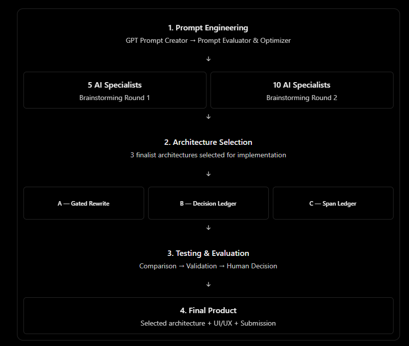
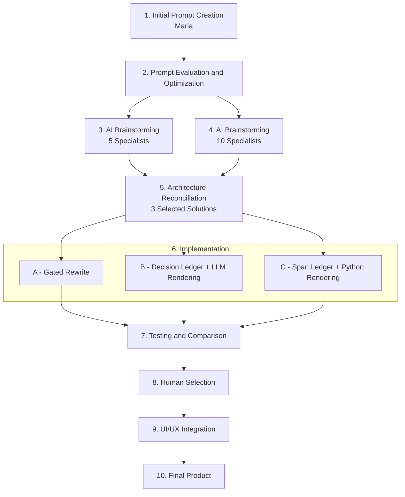

# JunctionX Lisbon 2026 — NOS Anonymization Challenge

**Team `portwineoverflow`** · NOS track "The \*-Files: Call for Anonymizing Prompts"

We did not just ask an AI to write an app. We ran two AI brainstorming rounds, checked the proposals against the official rules, implemented three candidate architectures and put them through the same tests before choosing. This README tells that story. Items marked `TODO` are waiting for the teammate who owns that part.

## 01 — Our Solution

**The problem.** NOS gives every team the same two-page, fictional medical report in Portuguese and asks for an LLM-based system that masks the personal data in it. Each sensitive word becomes a single `*`, the formatting stays, and empty lines are removed.

**What our system does.** It extracts the text of the PDF, asks Gemini to find personal data from context, and returns the same document with every sensitive word replaced by one `*`, leaving every other character untouched.

**A real result.** Part of the output of a live Gemini run (`gemini-3.8-flash`, architecture A, run `A-live-t02`):

```text
Before (fictional data)                              After
Nome: Maria Conceição Oliveira Santos                Nome: * * * *
Data de Nascimento: 12/03/1978                       Data de Nascimento: *
Morada: Rua das Flores, 123, Apt 45, Sacavém, Lisboa Morada: * * *, *, * *, *, *
Telefone: +351 912 345 678                           Telefone: * * * *
A paciente Maria Santos, mulher caucasiana ...       A paciente * *, mulher caucasiana ...
```

The short name inside the sentence is masked from context, not from a label. Health and demographic details stay under our current, provisional masking policy.

**Screenshot of the UI:** TODO: add once the interface is ready.

**Status, 10 Oct 2026 (evening):** three architectures implemented; A has real Gemini results; B and C are blocked by a request error and not measured yet; no final choice made; UI not in the repository yet.

## 02 — Development Journey





## 03 — How We Built It

### Stage 1 — Initial Prompt Engineering

- **Responsible:** Maria
- **AI model:** TODO(Maria)
- **Prompt:** TODO(Maria): link the selected prompts.
- **Work:** TODO(Maria): what you did and why you chose this approach.
- **Result:** TODO(Maria): what was passed to Stage 2.

### Stage 2 — Prompt Evaluation & Optimization

- **Responsible:** TODO
- **AI model:** a *GPT Prompt Creator* followed by a *Prompt Evaluator & Optimizer*. TODO: the models behind them.
- **Prompt:** TODO: link the prompt files.
- **Work:** TODO: how the first prompts were evaluated and what was improved.
- **Result:** the task prompts used in Stages 3 to 6. Each fixed a role, a budget, evidence rules and a stop condition.

### Stage 3 — Two AI Brainstorming Rounds

Idea generation and evaluation only. No production code was written here.

| | Round 1 — 5 agents | Round 2 — 10 agents |
|---|---|---|
| **Responsible** | TODO | TODO |
| **AI model** | Claude (5 specialized AI agents) | Claude (10 specialized AI agents) |
| **Prompt** | *MULTI-AGENT BRAINSTORMING — NOS HACKATHON 2026* | *CONTROLLED MULTI-AGENT BRAINSTORMING* |
| **Work** | Five AI specialists explored and critically evaluated eight potential architectures, to identify the three strongest before implementation. | An expanded round with ten specialists and stricter evaluation, technical criticism and feasibility analysis. The agents proposed and compared solutions independently, without writing production code. |
| **Selected solutions** | Guarded Single-Shot, Decision Ledger, Risk-Tiered Red-Team | Gated Rewrite, Span Ledger, Red-Team Ledger |

Round 2 in more detail: ten roles (prompt engineer, Python architect, NLP specialist, privacy specialist, document engineer, innovation researcher, adversarial tester, performance engineer, evaluation strategist, critical reviewer), one 400-word report each. Five distinct concepts came back; local entity recognition and a rule-compiler idea were rejected. TODO: link both round reports.

### Stage 4 — Architecture Reconciliation

- **Responsible:** TODO
- **AI model:** Claude Code (Claude Opus 5.5)
- **Prompt:** *Final Architecture Validation*
- **Work:** Instead of a third brainstorm, we checked three recommendations (Decision Ledger from round 1, Gated Rewrite and Span Ledger from round 2) against the official brief, the event regulations, the organisers' repository and the real PDF. Each rule was marked verified, inferred or unverified in the [evidence table](submission/NOS_Three_Agents/references/evidence_table.md).
- **Result:** three architectures to build (A, B, C, described in section 04) and a list of rules the brief leaves open.

### Stage 5 — Implementation

- **Responsible:** git history shows the commits by @Kotoliji, written with Claude Code. TODO: confirm names.
- **AI model:** Claude Code (Claude Opus 5.5)
- **Prompt:** *Build Three Runnable Agents and Benchmark Them*
- **Work:** Three independent pipelines in Python 3.11 behind one command line, sharing one extracted source text, one masking policy, one set of validators and one Gemini adapter (REST, no SDK). PyMuPDF reads the PDF; pytest and flake8 check the code.
- **Result:** [agents A, B and C](submission/NOS_Three_Agents/agents/), [shared code](submission/NOS_Three_Agents/shared/), 98 offline tests.

### Stage 6 — Testing & Comparison

- **Responsible:** TODO
- **AI model:** Gemini (`gemini-3.8-flash`) for live runs
- **Work:** Offline tests on synthetic text, then a live benchmark with frozen prompts: three trials per architecture, every trial kept, failures included.
- **Result:** see section 04.

### Key decisions and why

| Decision | Why |
|---|---|
| Two brainstorming rounds before any code | To compare many architectures cheaply and pick the three strongest before spending build time |
| Check finalists against official documents | The brief leaves key rules open (may code post-process the answer? is more than one prompt allowed?), so eligibility had to be checked, not assumed |
| Build A, B and C instead of one | Each fits a different answer to those open rules |
| One masking policy in a separate file | The brainstorm specialists disagreed on what to mask, and the organisers do not define it |
| Words addressed by line and word IDs | A model miscounts characters but copies quotes reliably; Python maps IDs to positions and rejects any mismatch |
| Model output is validated, never repaired | A failed answer is recorded as a failure, so results stay honest |
| Live runs on `gemini-3.8-flash` | The default `gemini-3.6-flash` hit the key's free-tier quota (HTTP 429) |

## 04 — Architecture & Results

### The three implementations

| | Architecture | How it works | Open rule it depends on |
|---|---|---|---|
| **A** | Gated Rewrite | One Gemini call returns the whole masked document. Python checks it and never edits it. | none |
| **B** | Decision Ledger + LLM Rendering | Call 1 returns masking decisions; call 2 renders the document from them. Python validates both. | Are two prompts allowed? |
| **C** | Span Ledger + Python Rendering | The model only points at sensitive spans. Python verifies them and applies the masks itself. | May code post-process the answer? |

### Results

**Code correctness (offline, no AI):** 98 tests pass and the lint check is clean. A MOCK benchmark also runs end to end. MOCK runs show that the code works; they are not AI performance and are not counted below.

**Real Gemini runs (LIVE, `gemini-3.8-flash`, 10 Oct 2026):**

| | A | B | C |
|---|---|---|---|
| Trials run | 3 of 3 | 1 of 3 | 1 of 3 |
| Strictly valid outputs | 1 of 3 | 0 | 0 |
| Valid if trailing spaces are ignored | 3 of 3 | — | — |
| Personal-data words masked (of 46 in our reference) | 46 in every trial | not measured | not measured |
| Words masked that should stay | 0 | not measured | not measured |
| What went wrong | 2 trials dropped the final trailing space | HTTP 400 on the first request | HTTP 400 on the first request |
| Time per run | 54 to 74 s | — | — |

How to read this:

- **A works.** In all three trials it masked exactly the words our reference marks as personal data and nothing else. Its only deviation was one missing space at the end of the last line, in two trials.
- **B and C are unmeasured, not worse.** Both failed before producing any output, on the request that asks Gemini for structured JSON. The cause is not diagnosed yet.
- **The reference is ours and unreviewed.** It was drafted from the same masking policy as the prompt, so full agreement shows that the model follows our policy. It does not show agreement with NOS's hidden reference. Three trials on one document prove nothing general.

Details: [comparison report](submission/NOS_Three_Agents/evaluation/comparison_report.md) and [per-trial tables](submission/NOS_Three_Agents/evaluation/benchmark_tables.md).

### Selected solution

TODO(team): which architecture we chose and why. Evidence so far: A is the only one with real results, and its eligibility depends on no open rule.

### UI integration

TODO: contributor(s), technologies, main features, how the interface calls the selected pipeline, screenshot or demo link.

### Open questions for the NOS mentors

1. Is health and other special-category data masked, or identifiers only?
2. May code transform the model's answer before `submission.txt`?
3. May a multi-step pipeline file more than one prompt?
4. Do trailing spaces and the PDF's line breaks count in the comparison?

## 05 — Setup & Team

### How to run

Windows PowerShell, Python 3.11:

```powershell
cd submission/NOS_Three_Agents
python -m venv .venv
.\.venv\Scripts\python.exe -m pip install -r requirements.txt
$py = ".\.venv\Scripts\python.exe"
& $py -I -X utf8 -m pytest                              # 98 offline tests
& $py -I -X utf8 run_agent.py --agent A --mode mock     # no key needed
```

For real Gemini runs, create a key at [Google AI Studio](https://aistudio.google.com/) and put it in `submission/NOS_Three_Agents/.env` as `GEMINI_API_KEY=...`. The file is git-ignored; never commit a key.

```powershell
$env:NOS_GEMINI_MODEL = "gemini-3.8-flash"              # the model our live runs used
& $py -I -X utf8 run_agent.py --agent A --mode live     # one request
& $py -I -X utf8 run_benchmark.py --mode live           # all three, three trials each
```

The masked document of a run is its `candidate.txt` under `runs/`. Limits, artifacts and all other commands are in the [technical guide](submission/NOS_Three_Agents/README.md).

### Team

| Contributor | Responsibility | Main work | Links |
|---|---|---|---|
| Maria | Stage 1, initial prompt engineering | TODO(Maria) | TODO |
| @Kotoliji | TODO: confirm | Commits for the shared core, agents A/B/C and evaluation | [PR #1](https://github.com/ThiagoHg80/nos-gen-ai-hackathon/pull/1) |
| @ThiagoHg80 | TODO: confirm | Owns the team fork; merged PR #1 | TODO |
| TODO | UI/UX | TODO | TODO |

### References

- **Official NOS and JunctionX material:** [challenge brief](https://lisbon.hackjunction.com/assets/challenges/NOS%20-%20JunctionX%20Lisbon%202026.pdf), [event regulations](https://lisbon.hackjunction.com/assets/JunctionX%20Lisbon%202026%20-%20Official%20Regulations.pdf), [organisers' repository and original README](https://github.com/nosportugal/nos-gen-ai-hackathon)
- **Organisers' files in this repository:** [problem statement and evaluation](tutorials/problem_and_eval.md), [submission guidelines](submission/README.md), [Gemini tutorial](tutorials/gemini_tutorial.md), [Git tutorial](tutorials/git_tutorial.md), [PDF-to-text notebook](tutorials/pdf__to__txt.ipynb), [document to anonymize](raw_data/document_to_anonymize.pdf)
- **Our evidence:** [evidence table](submission/NOS_Three_Agents/references/evidence_table.md), [masking policy](submission/NOS_Three_Agents/shared/policy/masking_policy_v1.json), [annotation policy](submission/NOS_Three_Agents/evaluation/annotation_policy.md)
- **Agent prompts:** [A](submission/NOS_Three_Agents/agents/A_gated_rewrite/system_prompt.txt), [B stage 1](submission/NOS_Three_Agents/agents/B_decision_ledger/stage1_system_prompt.txt), [B stage 2](submission/NOS_Three_Agents/agents/B_decision_ledger/stage2_system_prompt.txt), [C](submission/NOS_Three_Agents/agents/C_span_ledger/system_prompt.txt)
- TODO: Stage 1 and Stage 2 prompt files, and the two brainstorming reports
