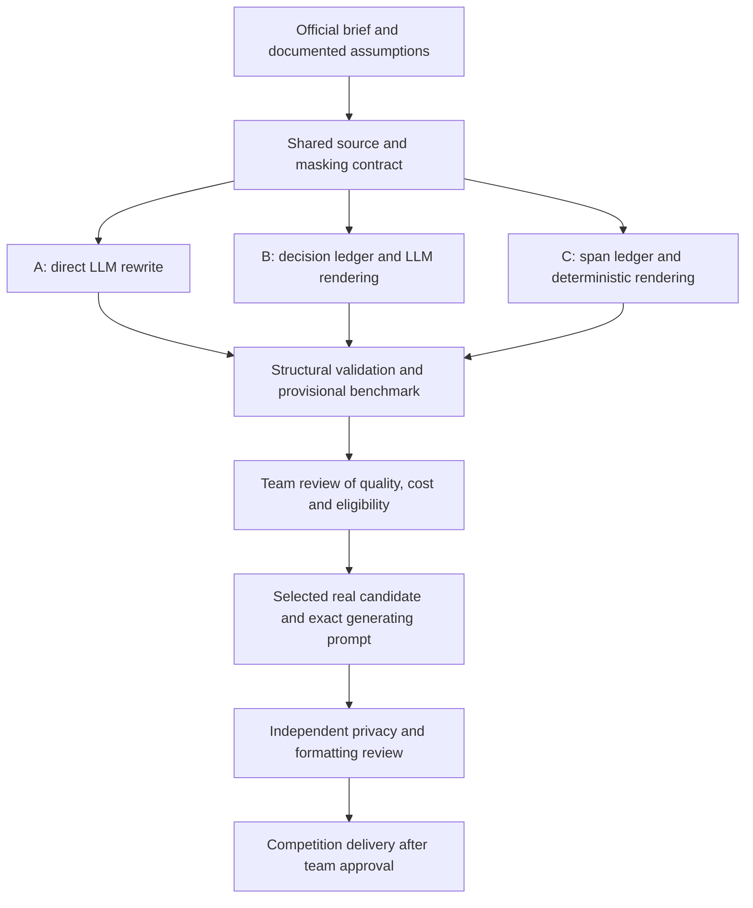

# NOS Three Agents — Team PortWineOverflow

Development and evaluation workspace for **The *-Files: Call for Anonymizing
Prompts**, the NOS track at JunctionX Lisbon 2026.

The project explores how an LLM can identify sensitive information from
context, replace each anonymized word with a single asterisk, and preserve
the document's meaning and formatting, removing empty lines. The shared
challenge input is [document_to_anonymize.pdf](../../raw_data/document_to_anonymize.pdf).
Its personal data is fictional, as stated in the competition brief.

The work developed from three comparable agent designs into a separate
single-call agent, a synthetic benchmark dataset, and optional privacy and
security checks. These components remain distinct so evaluation code does
not determine an agent's answer.

## Contents

- [Current status](#current-status)
- [Engineering rationale and development history](#engineering-rationale-and-development-history)
- [Architecture and repository layout](#architecture-and-repository-layout)
- [Environment and dependencies](#environment-and-dependencies)
- [Offline quick start](#offline-quick-start)
- [Running agents](#running-agents)
- [Privacy and security validation](#privacy-and-security-validation)
- [Source integrity and benchmark freeze](#source-integrity-and-benchmark-freeze)
- [Benchmarking and evidence](#benchmarking-and-evidence)
- [Competition delivery](#competition-delivery)
- [Collaboration](#collaboration)
- [Troubleshooting](#troubleshooting)
- [Limitations and references](#limitations-and-references)

## Current status

The last recorded local verification used **Python 3.12.7**:
**132 tests passed and one optional real-document check was skipped**.
Repository flake8, pip check, source hashes, and fresh PDF extraction passed.
No Gemini requests were made during that verification.
See [verified_environment.json](evaluation/verified_environment.json).

The repository also contains earlier artifacts labelled LIVE and three Agent A
rows in [benchmark_results.csv](evaluation/benchmark_results.csv), using the
recorded model identifier `gemini-3.8-flash`. These are historical results,
not results of the latest offline verification or the current freeze.
Their metrics use a provisional reference, not NOS's hidden evaluation.

[comparison_report.md](evaluation/comparison_report.md) is an earlier snapshot
that predates those LIVE artifacts; its statements about zero live runs and
98 tests are historical. Consult per-run artifacts and the environment record
for the corresponding evidence. Do not mix results from different freezes.

The provided [submission.txt](../submission.txt) and [prompt.txt](../prompt.txt)
were empty at the latest review. The three-agent workspace does not populate
them automatically. Tests passing does not mean the competition entry is ready.

## Engineering rationale and development history

The team's working notes describe a deliberate engineering process: refine
the baseline prompt, compare alternative architectures, implement a small set
of finalists, evaluate failures and trade-offs, and explain the final choice.
The intention is to make decisions understandable to teammates and reviewers,
rather than present an unexplained final output.

Early notes proposed a broader set of generation and red-team specialists.
A later brainstorming prompt narrowed the target to three finalists.
These are planning records, not evidence that a specific number of specialists
was actually invoked or that every proposed experiment was completed.
The current implementation and Git history establish the following stages:

| Stage | Evidence in Git | Engineering purpose |
|---|---|---|
| Shared extraction, policy and validators | `43a848c` | Give candidate architectures a common source and transformation contract |
| Three agent implementations | `65ff23f` | Compare direct rewriting, a decision ledger and deterministic rendering |
| Provisional reference and bounded metrics | `d227d37` | Separate code validation from measured agreement with a draft reference |
| Requirements evidence and initial reports | `54ffa6c`, `51cd136` | Distinguish official requirements, assumptions and offline evidence |
| Recorded Agent A trials | `9c165dc` | Preserve trial artifacts rather than infer performance from architecture |
| Synthetic benchmark documents | `dfb8c7e` | Exercise different document contexts with fictional identifiers |
| Separate LangChain agent | `c2d375d` | Decouple generation from benchmark evaluation |
| Local-model provider support | `2ac7b0e` | Allow testing against an explicitly configured local server |
| Optional multilingual privacy checks | `9f7681f` | Add independent entity detection without changing model output |
| Working rules and additive security checks | `25ac57a`, `82a4d28` | Explain risks, mitigations and the boundaries of the prototype |
| Verified environment and refreshed freeze | `bcedc87` | Record tested versions while preserving earlier experiment identities |

The implemented flow is:



The diagram describes the engineering workflow, not a claim that final
selection or delivery is complete. The separate LangChain agent is another
implementation of the single-call path; optional checks remain independent.

### Why these alternatives were retained

- **A:** minimizes stages and produces a complete model answer, but can omit
  identifiers or alter formatting. Structural checks reject some failures.
- **B:** makes masking decisions inspectable and compares them with rendering,
  at the cost of another inference call and additional failure modes.
- **C:** controls rendering in Python, but depends on correct model spans and
  an unresolved interpretation of the final-output submission requirement.

These are architectural trade-offs. Do not claim that C was selected, that
direct rewriting always failed, or that any design guarantees 100% fidelity
or privacy without supporting measurements and a recorded team decision.

### Data provenance is separate from execution mode

| Material / label | Meaning |
|---|---|
| NOS challenge PDF | Official challenge input containing fictional personal data; not evidence of access to real customer records |
| Synthetic 50-document benchmark | Team test data and benchmark-specific reference outputs; not corporate source documents |
| AI-drafted source annotations | A provisional evaluation reference, with review status recorded in `evaluation/annotation_policy.md` |
| MOCK | Local stand-in inference; no Gemini call, even when processing the official challenge text |
| LIVE | Artifacts record a real-provider execution path; the processed data may still be fictional |
| Final submission | The selected actual model/API result and its exact prompt; neither a mock fixture nor a process report |

?Fictional? describes data provenance. ?LIVE? describes the execution mode.
They must not be used interchangeably.

The draft reference explicitly records no human reviewer. The synthetic
dataset documentation likewise requests review before authoritative use.
Do not describe either as fully human-validated until the reviewer, date
and scope of review are recorded.

### Documentation and prompt provenance

Keep design history, model roles, contributor responsibilities and architecture
diagrams in documentation. Keep `submission/prompt.txt` reserved for the exact
prompt that generated the delivered output: it is not the place for a table
of brainstorming models, team members or the development history.

The working PDF includes prompt experiments and an AI-generated README draft.
They inform this explanation but do not override the official brief or prove
that proposed features exist. Its legal/privacy prompt wording is a design
proposal, not a compliance certification. UI/UX and production deployment
were proposed next steps; they are not implemented by the code reviewed here.

Do not copy credentials from working notes into documentation. If credentials
were shared in a planning document, revoke and replace valid ones through
the provider before reuse. Contributor attribution belongs to Git history
and verified team records; do not infer responsibilities from draft placeholders.

## Architecture and repository layout

### Three-agent comparison

| Agent | LLM responsibility | Python responsibility | Calls per successful run |
|---|---|---|---|
| A — Gated Rewrite | Return the complete masked document | Validate structure without repairing the answer | 1 |
| B — Decision Ledger + LLM Rendering | Return masking decisions, then render the document | Validate the ledger and its agreement with the answer | 2 |
| C — Span Ledger + Deterministic Rendering | Return sensitive spans | Validate spans and render the document deterministically | 1 |

Each uses the same canonical source, provisional masking policy, API adapter
and result contract. Agent A's design most directly follows a complete
model-generated answer. Whether the multi-call and deterministic-rendering
designs are acceptable final submissions is not explicitly resolved by the
brief; see [evidence_table.md](references/evidence_table.md).

The separate [agent/](../agent/README.md) component uses LangChain to connect
PDF extraction, a reviewed prompt, and one model call. It supports Gemini and
an OpenAI-compatible local server. It is not the same runner as agent A above.

### Layout

Paths below are relative to the repository root.

| Path | Purpose |
|---|---|
| `raw_data/document_to_anonymize.pdf` | Organisers' challenge document |
| `submission/submission.txt`, `submission/prompt.txt` | Required final output and exact generating prompt |
| `submission/agent/` | Separate single-call agent and offline tests |
| `submission/benchmark/input/`, `ground_truth/` | 50 fictional benchmark documents and reference outputs |
| `submission/benchmark/annotations.json` | Character spans and labels for that synthetic dataset |
| `submission/security_preflight.py` | Optional read-only checks of indexed secrets, local URLs and candidates |
| `submission/NOS_Three_Agents/agents/` | Three experimental agent implementations |
| `submission/NOS_Three_Agents/shared/` | Runtime utilities and optional privacy checker |
| `submission/NOS_Three_Agents/input/` | Original PDF, extracted text and source manifest |
| `submission/NOS_Three_Agents/evaluation/` | Reference, metrics, reports, freeze and environment record |
| `submission/NOS_Three_Agents/runs/` | Historical and newly generated per-run artifacts |
| `submission/AGENTS.md` | Project working instructions |
| `submission/COMPETITION_COMPLIANCE.md` | Requirements review, security findings and remaining delivery steps |

The synthetic dataset uses a benchmark-specific masking policy. It is not
NOS's hidden reference. Some older component documentation mentions
`original/`; the directory present in this checkout is `input/`.

## Environment and dependencies

Use one agreed interpreter for installation and execution. The current
locally verified version is **Python 3.12.7 on Windows**. Installing several
Python versions does not change the code, but invoking a different interpreter
can select different packages and invalidate the benchmark freeze.

| Dependency | Recorded version | Purpose |
|---|---|---|
| PyMuPDF | 1.27.2.3 | PDF extraction |
| pytest | 9.1.1 | Tests |
| flake8 | 7.4.1 | Repository lint |
| presidio-analyzer | 2.2.364 | Optional privacy detection |
| presidio-anonymizer | 2.2.364 | Included optional package; current checks do not rewrite text |
| spaCy | 3.8.16 | Optional NLP pipeline |
| xx-ent-wiki-sm | 3.8.0 | Shared multilingual entity model |
| Great Expectations | 1.24.0 | Optional zero-findings table validation |
| pandas | 3.0.6 | Optional findings table |
| langchain-core | 1.6.9 | Separate agent pipeline |
| langchain-google-genai | 4.4.1 | Separate agent's Gemini integration |
| langchain-openai | 1.7.0 | Separate agent's local-server integration |

The base [requirements.txt](requirements.txt) contains the extraction and
test/lint dependencies. [requirements-privacy.txt](requirements-privacy.txt)
includes the base file and pins the optional privacy packages and model.
The table records the tested top-level versions; it is not a complete
transitive dependency lock. The recorded checks were performed in the existing
local environment, not a newly provisioned clean machine. Linux/macOS and
other Python versions have not been verified by this check.

### Create a local environment

Open PowerShell at the repository root. `python` must resolve to Python
3.12.7; check it first. If necessary, replace it with the full path to that
interpreter. Do not copy the terminal's `PS ...>` prefix.

```powershell
python --version
cd ".\submission\NOS_Three_Agents"
python -m venv .venv
$py = (Resolve-Path ".\.venv\Scripts\python.exe").Path
$workspace = (Get-Location).Path
$submission = (Resolve-Path "..").Path
$repo = (Resolve-Path "..\..").Path
& $py -m pip install -r requirements.txt
```

Keep these variables in the same terminal session. No activation script is
required. Always use `& $py -m pip`, rather than an unrelated `pip` executable.

For optional multilingual privacy checks:

```powershell
& $py -m pip install -r requirements-privacy.txt
```

To reproduce the separate agent's recorded top-level integrations:

```powershell
& $py -m pip install langchain-core==1.6.9 langchain-google-genai==4.4.1 langchain-openai==1.7.0
& $py -m pip check
```

Package installation downloads dependencies. Tests and mock inference do not
need a Gemini API key. The multilingual model download is approximately
11 MB; the other optional packages add further installation size.

## Offline quick start

From `$workspace`, run the three-agent suite:

```powershell
& $py -B -I -X utf8 -m pytest -ra
```

From `$submission`, run both suites together:

```powershell
Set-Location $submission
$env:LANGSMITH_TRACING = "false"
$env:LANGCHAIN_TRACING_V2 = "false"
$env:GX_ANALYTICS_ENABLED = "false"
& $py -B -X utf8 -m pytest agent/tests NOS_Three_Agents -ra -o addopts="-p no:cacheprovider"
```

The separate agent imports its package from `submission/`, so this combined
command intentionally does not use `-I`. The three-agent entry-point scripts
explicitly set their own import path and support `-I`.
Some tests use a loopback HTTP stub; they do not call a real model.

Privacy tests skip if optional packages or the spaCy model are absent.
The real-document check skips unless `NOS_PRIVACY_DOCUMENT` is set.
Read the skip summary rather than treating skips as coverage.

Run the organisers' lint command across the repository:

```powershell
Set-Location $repo
& $py -B -m flake8 .
git diff --check
```

## Running agents

### Three-agent runner: offline mock

From `$workspace`:

```powershell
Set-Location $workspace
& $py -B -I -X utf8 run_agent.py --agent A --mode mock
& $py -B -I -X utf8 run_agent.py --agent B --mode mock
& $py -B -I -X utf8 run_agent.py --agent C --mode mock
```

Mock mode generates local stand-in output labelled MOCK. It writes new
artifacts under `runs/`; it is not a read-only command and does not establish
LLM accuracy. Exit codes are 0 for a structurally valid candidate, 1 for an
invalid candidate/pipeline failure, and 2 for a blocked run.

### Three-agent runner: live

A live run sends the document to Gemini and consumes API quota. Run it only
when the team authorizes the call and its data handling. Configure
`GEMINI_API_KEY` or `GOOGLE_API_KEY` in the process environment, or use the
untracked `.env` file in this workspace. See [.env.example](.env.example).
Never publish keys in Git, logs, screenshots or chat.

```powershell
& $py -B -I -X utf8 run_agent.py --agent A --mode live
```

The current configured model identifier is `gemini-3.6-flash`, from
[model_config.json](shared/model_config.json). This describes configuration,
not a guarantee that the model is available to your account.
`NOS_GEMINI_MODEL` overrides it and changes the freeze state.
The adapter uses REST with the standard library, sending the key in a header.

The local request budget permits 24 HTTP inference attempts across runs,
including failed attempts and retries. A stage permits at most one retry
for transient transport/service errors. Invalid model content is not retried.
The budget file is `runs/_budget/live_requests.jsonl`; do not delete it to
reset the count. This local counter is not the provider's billing/quota.

Output is capped at 16,384 tokens; timeout is 120 seconds. Oversized input
is refused instead of silently chunked. Truncated or blocked responses are
not reported as successful candidates. These limits belong to this runner,
not automatically to the separate LangChain agent.

### Separate single-call agent

Run its commands from `$submission`. Its `prompt.txt` must be nonempty.
The current checkout does not contain the example `prompts/` directory
mentioned in older documentation. Select a reviewed prompt file that actually
exists; do not pass an unexpanded three-agent template as its system prompt.

```powershell
Set-Location $submission
& $py -B -X utf8 -m agent --help
```

After reviewing a prompt, substitute its actual path below:

```powershell
& $py -B -X utf8 -m agent --provider gemini --prompt "path\to\reviewed_prompt.txt" --out "candidate_review.txt"
```

A local-server run requires a separately installed and running
OpenAI-compatible server. This repository does not install a local model.
Check the exact endpoint before using it:

```powershell
& $py -B security_preflight.py --local-url "http://localhost:8080/v1"
& $py -B -X utf8 -m agent --provider local --base-url "http://localhost:8080/v1" --prompt "path\to\reviewed_prompt.txt" --out "candidate_review.txt"
```

The separate agent always extracts the PDF to
`submission/raw_uncensored_document.txt`, including during `--dry-run`.
Dry-run also prints the prompt and part of the input. A failed model call
does not write a new answer, but extraction may already have written raw text.

Its default output is `submission.txt`. When writing there with another
prompt file, it also copies the instruction text into `prompt.txt`.
Use a separate `--out` path while experimenting to preserve delivery files.
Its key file is `submission/.env`, unlike the three-agent workspace's
`submission/NOS_Three_Agents/.env`.

## Privacy and security validation

### Presidio and Great Expectations

One shared `xx_ent_wiki_sm` instance serves English, Portuguese and Spanish.
The checker detects PERSON, EMAIL_ADDRESS, PHONE_NUMBER, LOCATION and
ORGANIZATION, combines findings across languages and removes duplicates.
Phone recognition covers configured regions PT, ES, US, GB and BR; this is
not exhaustive worldwide coverage.

The check uses a score threshold of 0.4 so phone detections without context
are included. Scores are heuristic, not calibrated probabilities.
Great Expectations validates that the findings table has zero rows, with
analytics disabled and in-memory stores. Domain validation uses bundled
rules rather than downloading them during checks.

To inspect an existing candidate:

```powershell
Set-Location $workspace
$env:NOS_PRIVACY_DOCUMENT = (Join-Path $submission "candidate_review.txt")
& $py -B -I -X utf8 -m pytest tests/test_censorship.py -v -ra
Remove-Item Env:NOS_PRIVACY_DOCUMENT
```

Replace the filename with a real candidate. Explicit missing or empty input
fails. The original NOS PDF/text contains intentional personal information;
running a leak check on the original is a detector demonstration, not a
failed anonymization.

The checks report entity types and offsets without printing sensitive
fragments. They never rewrite the candidate. No findings do not prove
anonymity; false positives and negatives require human review.

### Optional read-only preflight

From `$submission`:

```powershell
Set-Location $submission
& $py -B security_preflight.py
& $py -B security_preflight.py --document "candidate_review.txt"
```

The default scan reads Git's index: stage only the intended, reviewed files
before scanning. Unstaged/untracked files and earlier history are outside
its scope. Selected patterns cover Google API keys, classic GitHub tokens
and private-key headers; other formats can be missed.

`--local-url` restricts an endpoint to loopback and rejects credentials,
query parameters and fragments. It does not configure the agent or enforce
network restrictions on another process.
Exit codes: 0 no configured findings; 1 findings require review; 2 incomplete
check. Findings must be reviewed, not automatically removed to satisfy a test.

The preflight is optional and does not intercept every agent execution or
publication. See [COMPETITION_COMPLIANCE.md](../COMPETITION_COMPLIANCE.md)
for each finding, mitigation, rationale and remaining risk.
Do not reuse this prototype with real customer documents until storage,
access, retention, provider and logging controls have been reviewed.

## Source integrity and benchmark freeze

The canonical source preserves PyMuPDF's extraction with newline normalization
only. Its manifest records PDF/text hashes and extraction details.
This workspace stores files byte-for-byte through [.gitattributes](.gitattributes);
do not normalize frozen files or remove trailing spaces to silence checks.

The active policy is [masking_policy_v1.json](shared/policy/masking_policy_v1.json).
The v2 file exists but is not selected by `shared/config.py`.
Policy assumptions about categories, word boundaries and punctuation are
provisional, not additional official competition rules.

The current freeze records Python 3.12.7, PyMuPDF and configured file hashes.
The previous Python 3.11.9 freeze is archived unchanged under
[freeze_history/](evaluation/freeze_history/).
Historical run hashes refer to their own original configuration.

On a deliberate, reviewed configuration change:

1. Inspect the freeze differences and run the relevant offline checks.
2. Preserve the old manifest and its identity.
3. Use the existing command with an English explanation:

```powershell
Set-Location $workspace
& $py -B -I -X utf8 run_benchmark.py --freeze --note "Describe the reviewed configuration change and verification."
```

This command overwrites the active manifest file and does not call Gemini.
Do not run it merely to bypass an unexplained mismatch.
Do not change prompts, settings or policies between comparable measured trials.
The freeze does not lock every transitive dependency or prevent another team
member editing files concurrently.

Inputs are already tracked. Rebuilding is a maintenance task, not required
for the quick start. `references/fetch_references.py` downloads external
references; `prepare_source.py` refuses to overwrite changed frozen text
without `--force`. `evaluation/build_reference.py` generates a provisional
reference. Review such operations before replacing evidence.

## Benchmarking and evidence

A full three-agent benchmark defaults to three trials per agent:
12 successful-stage inference calls, with retries potentially increasing
HTTP attempts. It consumes quota in live mode.

```powershell
Set-Location $workspace
& $py -B -I -X utf8 run_benchmark.py --mode mock
# Only after explicit team authorization:
& $py -B -I -X utf8 run_benchmark.py --mode live
```

These commands generate run/index artifacts and evaluation summaries.
They can update summary files; preserve prior evidence before rerunning.
Configuration-level failures stop further equivalent trials for that agent.

Each run records request text, raw response, candidate when available,
validation, model usage and timings. Artifacts are marked read-only:
that is protection against accidental writes, not encryption or access control.
Raw inputs/responses may contain unmasked values.

Statuses are `CANDIDATE_VALID`, `CANDIDATE_INVALID` and `PIPELINE_FAILED`.
VALID means structural validation passed; it does not establish complete
privacy, hidden-reference agreement or official eligibility.

Re-score a saved index without a model call, using new output names:

```powershell
& $py -B -I -X utf8 evaluation/evaluate_runs.py --index "runs/_benchmarks/SELECTED_INDEX.json" --out-csv "evaluation/review_results.csv" --out-md "evaluation/review_tables.md"
```

Replace SELECTED_INDEX with an existing reviewed index.
The 50-document dataset under `submission/benchmark/` is a separate
benchmark-specific resource. This checkout does not contain executable
`benchmark.mask_diff`, `benchmark.mask_syntax_validation` or `benchmark/tests`;
older commands naming them are not runnable here.

## Competition delivery

The user-supplied NOS JunctionX brief, pages 2–5, is the event-specific
authority. The original generic repository tutorial may describe older
events. Detailed evidence and ambiguities are recorded in
[evidence_table.md](references/evidence_table.md) and
[COMPETITION_COMPLIANCE.md](../COMPETITION_COMPLIANCE.md).

Before final delivery:

1. Select a real model-generated output; preserve the exact prompt and run
   provenance. Never substitute MOCK output or test fixtures for a real entry.
2. Review one asterisk per anonymized word, preserved meaning/layout, removed
   empty lines and potential missed or excessive masking.
3. Populate the provided `submission/submission.txt` with only the required
   model/API output as returned by the system, without explanations or wrappers.
   Populate `submission/prompt.txt` with the exact generating prompt.
   Do not rename, move or delete either file.
4. Include development code, clear setup/usage documentation, library references
   and the open-source licence. Confirm a public team fork.
5. Run tests and repository flake8; inspect the intended diff.
6. Commit with each contributor's own identity and preserve team history.
7. After team approval, push the working branch and open a PR to `main` in
   `nosportugal/nos-gen-ai-hackathon`.
8. Register the PR link on JunctionX before the challenge closes and prepare
   a pitch of at most two minutes.

Three organiser workflows assess output, prompt and Python lint.
Missing delivery files may make a workflow skip and still appear green:
a green check alone is not evidence of a valid score.

The rubric allocates 40% to implementation, 30% to collaboration,
10% to documentation and 20% to pitch creativity.

## Collaboration

Continue on `team-portwineoverflow` as agreed by this team.
Never develop directly on `main`. The brief does not prohibit additional
branches, but this task's agreed workflow remains on the current branch.

Inspect `git status` and diffs before editing, staging or integrating.
Use small commits organized by purpose, with English titles and explanations
of significant decisions and validation. Preserve teammates' edits.
Stage explicit filenames rather than unrelated changes.

Use merge-based synchronization after saving reviewed local work.
Do not squash, rebase shared history, force-push, discard changes, or change
another contributor's identity. These precautions preserve the collaboration
evidence assessed by the competition.
The working instructions are in [AGENTS.md](../AGENTS.md).

## Troubleshooting

| Symptom | Check / action |
|---|---|
| requirements.txt or a test is not found | Confirm the working directory; paths are relative to it. Quote paths with spaces. |
| PowerShell rejects a cd path | Navigate to a quoted directory, not to a .py file. |
| A package is missing | Install with the same interpreter used to execute: `& $py -m pip ...`. |
| pytest selects a different Python | Use `& $py -m pytest` rather than bare `pytest`. |
| Privacy tests skip | Install requirements-privacy.txt and inspect the skip reason. |
| Explicit document validation fails on empty input | Supply an actual candidate; do not remove the empty-input check. |
| freeze check fails | Compare Python/version/file differences; review and document a deliberate refresh rather than bypassing it. |
| No key or model access | Offline tests/mock mode remain available; live access must be configured separately. |
| Local-server connection fails | Confirm an approved loopback endpoint and a running server; the repository does not start one. |
| A run directory already exists | A timestamp-based collision has occurred in a test before; preserve artifacts and report it rather than overwriting them. |
| Candidate is structurally valid but privacy findings remain | Review findings and masking policy; structural validity is not anonymity. |

## Limitations and references

This is a hackathon prototype, not a certified enterprise data-loss prevention
service. Detection covers a limited set of entities/languages/regions.
It does not guarantee identification of national IDs, bank accounts,
credentials in every format, health details, indirect identifiers or all
contextual personal information.

Prompt tags and instruction separation are useful but do not guarantee
resistance to prompt injection. Provisional labels and historical high metrics
are not official scores. Model availability, billing and output quality must
be verified for the actual authorized run.

No changes in this workspace establish production encryption, access
control, retention, provider approval or incident response.
Use fictional challenge/synthetic data and review deployment separately.

Referenced tools:

- [PyMuPDF](https://pymupdf.readthedocs.io/) — PDF extraction.
- [LangChain](https://docs.langchain.com/) — separate agent pipeline/integrations.
- [Gemini API](https://ai.google.dev/gemini-api/docs) — configured cloud provider.
- [Presidio](https://github.com/microsoft/presidio) — privacy entity detection.
- [spaCy multilingual models](https://spacy.io/models/xx) — shared NER pipeline.
- [Great Expectations](https://docs.greatexpectations.io/) — findings-table validation.
- [pandas](https://pandas.pydata.org/docs/) — findings dataframes.
- [pytest](https://docs.pytest.org/) and [flake8](https://flake8.pycqa.org/) — verification.
- [OWASP prompt injection guidance](https://cheatsheetseries.owasp.org/cheatsheets/LLM_Prompt_Injection_Prevention_Cheat_Sheet.html) — security review reference.

The repository carries the [MIT licence](../../LICENSE). Preserve the licence
and upstream notices; third-party packages retain their own licences.
