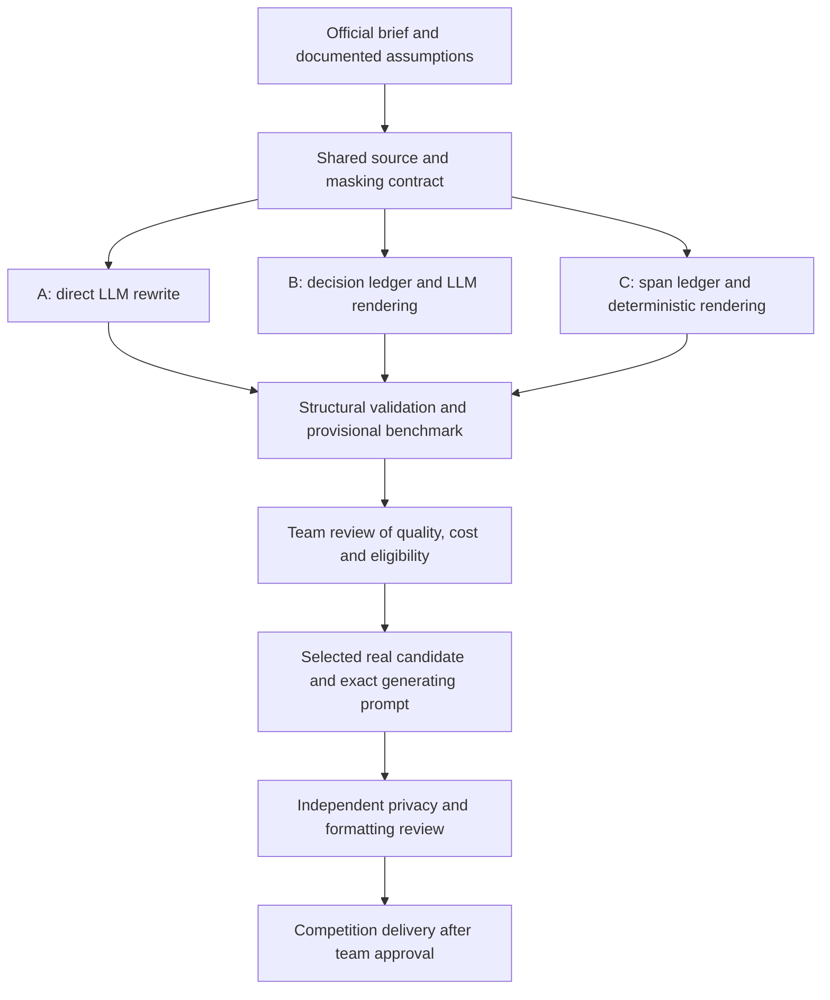

# NOS Three Agents — Team PortWineOverflow

Development and evaluation workspace for **The *-Files: Call for Anonymizing
Prompts**, the NOS track at JunctionX Lisbon 2026.

The project explores how an LLM can identify sensitive information from
context, replace each anonymized word with a single asterisk, and preserve
the document's meaning and formatting, removing empty lines. The shared
challenge input is [document_to_anonymize.pdf](../../raw_data/document_to_anonymize.pdf).
Its personal data is fictional, as stated in the competition brief.

The work developed from three comparable agent designs into a separate
single-call agent, a synthetic benchmark dataset, and optional privacy and
security checks. These components remain distinct so evaluation code does
not determine an agent's answer.

[Documentation index](../00_INDEX.md) links to the component guides and review records.

## Contents

- [Current status](#current-status)
- [Prompt versions and comparison interface](#prompt-versions-and-comparison-interface)
- [Engineering rationale and development history](#engineering-rationale-and-development-history)
- [Architecture and repository layout](#architecture-and-repository-layout)
- [Environment and dependencies](#environment-and-dependencies)
- [Offline quick start](#offline-quick-start)
- [Running agents](#running-agents)
- [Privacy and security validation](#privacy-and-security-validation)
- [Source integrity and benchmark freeze](#source-integrity-and-benchmark-freeze)
- [Benchmarking and evidence](#benchmarking-and-evidence)
- [Competition delivery](#competition-delivery)
- [Collaboration](#collaboration)
- [Troubleshooting](#troubleshooting)
- [Limitations and references](#limitations-and-references)

## Current status

Pre-pull maintenance verification (2026-10-11): **151 offline tests passed,
one real-document check skipped**, with repository flake8 and whitespace
checks passing. No model requests were made; this does not refresh the freeze.
For unresolved delivery checks, see the
[current review](../COMPETITION_COMPLIANCE.md#review-findings) and
[candidate privacy status](../COMPETITION_COMPLIANCE.md#current-candidate-privacy-review).

**Historical evidence:** [verified_environment.json](evaluation/verified_environment.json)
records an earlier Windows/Python 3.12.7 verification with 132 passing tests
and one skip. [Live results](evaluation/benchmark_tables.md) record three
Agent A trials with model identifier `gemini-3.8-flash`, against a provisional
reference. [Mock results](evaluation/mock_benchmark_results.csv) exercise
the pipeline only. These records describe their own configurations, not
the current code's model quality or NOS's hidden evaluation.

The provided [submission.txt](../submission.txt) and [prompt.txt](../prompt.txt)
are nonempty. The prompt matches `../prompts/prompt_v3_2.txt`. The exact
generating request/response provenance remains unverified. The three-agent
workspace does not populate these files automatically.

## Prompt versions and comparison interface

The repository separates model instructions, generation, validation and
visual inspection of saved files. Generation provenance requires a recorded
request and response; commit authorship does not establish that provenance.

### Prompt and current output

| Version | Difference visible in the tracked prompt |
|---|---|
| v3 | Defines the masking policy and word/punctuation rules |
| v3.1 | Adds short words such as de, da, do and e to the employer-name instruction |
| v3.2 | Adds an N-words-to-N-asterisks rule and a five-word employer example |
| v3.4 | Proposes masking who and when while retaining clinical content; see the [policy comparison](../benchmark/real_document/README.md#what-v34-adds-to-v32) |

`submission/prompt.txt` matches
[the v3.2 prompt](../prompts/prompt_v3_2.txt). The word-count checker confirms
**60/60 aligned lines and 58 asterisks** in the tracked output. Asterisks are
character counts, not independently verified sensitive-word detections.
Alignment does not prove unchanged words, spacing, correct masking or anonymity.
No intermediate v3/v3.1 measurements are established by these prompt files.

The pull added a separate [v3.4 prompt](../prompts/prompt_v3_4.txt),
a proposed reference and a saved answer in
[benchmark/real_document](../benchmark/real_document/README.md).
They do not replace the v3.2 delivery files. Use that guide for the
policy differences, reference assumptions and evaluation commands.

The single-call agent defaults to `gemini-3.6-flash` and requests temperature
0.0; `--model` can override that name. Its current configuration does not
identify the model used for the existing output. Exact generating
request/response provenance remains unverified.

The v3.2 prompt asks for masking of direct identifiers and selected contextual
attributes: names, birth dates, government/professional identifiers, addresses,
contacts, financial/biometric identifiers, age values, ethnicity, religion,
employer names and income. It asks to retain clinical content, occupation,
sex, marital status, number of children, insurance plan names, habits and
selected event dates. These are instructions to the model; the agent does
not enforce the categories or verify compliance.

The client accepts both the `.text` property and `.text()` method and checks
the response finish reason. Its default timeout is 300 seconds, configurable
with `--timeout`. These code paths do not establish compatibility of the
entire project with older Python/dependency combinations. For setup and
commands, use [the agent README](../agent/README.md).

### View the saved output

This guide opens the saved comparison in a browser. You only need Python 3
and a browser; no API key or additional Python packages are needed. The
interface displays saved files and does not generate a new masked document.

#### 1. Download and locate the project

If you already have the project, use your existing folder. Otherwise, open
[the team branch](https://github.com/ThiagoHg80/nos-gen-ai-hackathon/tree/team-portwineoverflow),
select **Code > Download ZIP**, and extract the ZIP before continuing.
Use the team branch because the original `main` branch does not contain this interface.

Open the extracted project folder. This is the repository root: it contains
`raw_data`, `submission` and `tutorials`. Open this folder, rather than
the `submission` or `interface` folder.

#### 2. Open a terminal and check Python

On **Windows**, open the project folder in File Explorer, type `powershell`
in its address bar and press **Enter**. In the window that opens, run:

```powershell
python --version
```

If that command is unavailable, try `py --version`. If it reports Python 3,
use `py` instead of `python` in the Windows server command below.

On **Linux**, open a terminal in the project folder using your file manager's
**Open in Terminal** option, if available. Alternatively, open a terminal and
run `cd "/path/to/project"`, replacing the example path with your actual
project folder. Then run:

```bash
python3 --version
```

The command should report `Python 3.x.x`. If Python is missing, follow
[the official Python installation instructions](https://www.python.org/downloads/)
for your operating system, then close and reopen the terminal and repeat
the check. For running the model and tests, follow the separate project
setup instructions; viewing the interface does not require that setup.

#### 3. Start the local server

Run the command for your operating system from the repository root.

**Windows PowerShell:**

```powershell
python -m http.server 8000 --bind 127.0.0.1
```

**Linux:**

```bash
python3 -m http.server 8000 --bind 127.0.0.1
```

Leave this terminal open. A message beginning with `Serving HTTP on`
means the server has started. The terminal stays occupied while it serves
the files; this is expected.

#### 4. Open and use the interface

Copy this address into your **browser's address bar**, then press **Enter**:

[http://localhost:8000/submission/interface/index.html](http://localhost:8000/submission/interface/index.html)

The [static interface](../interface/index.html) loads
`submission/raw_uncensored_document.txt` on the left and
`submission/submission.txt` on the right. These are the original and saved
output files. There is no upload or generation step on this page.

A word in the original is highlighted when its paired output word differs
and contains an asterisk. Use the theme toggle to change the appearance;
the panels stack on narrow screens. The page displays load/empty-file
errors and alignment counts. A line with a different word count is shown
without highlights; different line counts disable all original highlights.
These visual checks are separate from the masking syntax and privacy checks:
opening the page successfully does not establish that the output passes them.

If either saved file changes, refresh the browser to reload the comparison.

#### 5. Stop the server

Return to the terminal and press **Ctrl+C**. The command prompt returns,
and the server stops. Repeat steps 3 and 4 whenever you want to open the
comparison again.

#### Common problems

| What you see | What to do |
|---|---|
| `python` is not recognised on Windows | Try `py --version` and use `py` for the server if it reports Python 3. Otherwise install Python and reopen the terminal. |
| `python3` is not found on Linux | Install Python 3 for your distribution, reopen the terminal and repeat the version check. |
| The browser cannot connect | Check that the terminal still shows the running server and that the browser address uses the same port. |
| `404 File not found` | Stop the server with Ctrl+C, open the repository root containing `submission`, and start it again there. Check the full browser address above. |
| The port is already in use | Replace `8000` with `8001` in the server command and in the browser address. |
| The page opens but cannot load a text file | Use the HTTP address above instead of opening the HTML file directly with `file://`. Confirm that both text files exist in `submission` and are not empty. |
| The page reports different line or word counts | The files loaded, but their structure does not align. Review the saved output and the [syntax validation instructions](../benchmark/README.md); restarting the server does not repair an output file. |

For generation commands, continue with [agent usage](../agent/README.md#run).
For other tasks, return to the [documentation index](../00_INDEX.md).

## Engineering rationale and development history

PDF extraction and newline canonicalisation live in `prepare_source.py`,
which is their only caller. The former `shared/extraction.py` was consolidated
there to keep preparation logic together. Historical freeze manifests retain
the old path; live runs remain blocked until an intentional new freeze.

Our design starts with a shared source and an explicit masking contract.
We compare direct rewriting, an inspectable decision ledger with model
rendering, and span detection with deterministic rendering. A common source,
policy and evaluation makes their differences easier to assess.

The separate single-call agent provides a smaller generation path.
Evaluation remains outside it so checks report failures without rewriting
the model answer. Versioned prompts make instruction changes visible; raw
responses and run records support reproducible comparisons. The v3.2 prompt
adds a counting rule and a multiword example to address collapsed masks.

Word counts provide a quick structural signal. Syntax validation,
reference-based metrics and privacy detection answer different questions,
so we retain them separately. The browser view helps inspect saved files
and complements these checks. Improvements need measured evidence rather
than assumptions about which architecture should perform best.

The implemented flow is:



The diagram describes the engineering workflow, not a claim that final
selection or delivery is complete. The separate LangChain agent is another
implementation of the single-call path; optional checks remain independent.

### Why these alternatives were retained

- **A:** minimizes stages and produces a complete model answer, but can omit
  identifiers or alter formatting. Structural checks reject some failures.
- **B:** makes masking decisions inspectable and compares them with rendering,
  at the cost of another inference call and additional failure modes.
- **C:** controls rendering in Python, but depends on correct model spans and
  an unresolved interpretation of the final-output submission requirement.

B's validator computes a deterministic rendering to check the model's
second-stage output. That extra call retains a model-written candidate;
it does not add a rendering capability absent from C. A's rewrite is
checked after generation, while B and C validate decision categories and
locations before rendering. Correct spans do not establish complete
sensitive-data detection.

A is the simpler baseline for a complete model response. Before choosing
B or C for delivery, clarify whether multiple prompts and deterministic
post-processing meet the exact-prompt/output requirements. Three Agent A
trials on one document, using a provisional reference, do not establish
general superiority over the other architectures.

These are architectural trade-offs. Do not claim that C was selected, that
direct rewriting always failed, or that any design guarantees 100% fidelity
or privacy without supporting measurements and a recorded team decision.

### Data provenance is separate from execution mode

| Material / label | Meaning |
|---|---|
| NOS challenge PDF | Official challenge input containing fictional personal data; not evidence of access to real customer records |
| Synthetic 50-document benchmark | Team test data and benchmark-specific reference outputs; not corporate source documents |
| AI-drafted source annotations | A provisional evaluation reference, with review status recorded in `evaluation/annotation_policy.md` |
| MOCK | Local stand-in inference; no Gemini call, even when processing the official challenge text |
| LIVE | Artifacts record a real-provider execution path; the processed data may still be fictional |
| Final submission | The selected actual model/API result and its exact prompt; neither a mock fixture nor a process report |

`Fictional` describes data provenance. `LIVE` describes the execution mode.
They must not be used interchangeably.

The draft reference explicitly records no human reviewer. The synthetic
dataset documentation likewise requests review before authoritative use.
Do not describe either as fully human-validated until the reviewer, date
and scope of review are recorded.

### Prompt and output provenance

We keep design rationale in documentation and the generating instruction
in `submission/prompt.txt`. Matching prompt files help inspection, but
output provenance requires the recorded request and response. The interface
displays saved files; it does not generate or validate them.

## Architecture and repository layout

### Three-agent comparison

| Agent | LLM responsibility | Python responsibility | Calls per successful run |
|---|---|---|---|
| A — Gated Rewrite | Return the complete masked document | Validate structure without repairing the answer | 1 |
| B — Decision Ledger + LLM Rendering | Return masking decisions, then render the document | Validate the ledger and its agreement with the answer | 2 |
| C — Span Ledger + Deterministic Rendering | Return sensitive spans | Validate spans and render the document deterministically | 1 |

Each uses the same canonical source, provisional masking policy, API adapter
and result contract. Agent A's design most directly follows a complete
model-generated answer. Whether the multi-call and deterministic-rendering
designs are acceptable final submissions is not explicitly resolved by the
brief; see [evidence_table.md](references/evidence_table.md).

The separate [agent/](../agent/README.md) component uses LangChain to connect
PDF extraction, a reviewed prompt, and one model call. It supports Gemini and
an OpenAI-compatible local server. It is not the same runner as agent A above.

### Layout

Paths below are relative to the repository root.

| Path | Purpose |
|---|---|
| `raw_data/document_to_anonymize.pdf` | Organisers' challenge document |
| `submission/submission.txt`, `submission/prompt.txt` | Required final output and exact generating prompt |
| `submission/agent/` | Separate single-call agent and offline tests |
| `submission/interface/index.html` | Browser comparison of saved original and output files |
| `submission/benchmark/input/`, `ground_truth/` | 50 fictional benchmark documents and reference outputs |
| `submission/benchmark/annotations.json` | Character spans and labels for that synthetic dataset |
| `submission/security_preflight.py` | Optional read-only checks of indexed secrets, local URLs and candidates |
| `submission/NOS_Three_Agents/agents/` | Three experimental agent implementations |
| `submission/NOS_Three_Agents/shared/` | Runtime utilities and optional privacy checker |
| `submission/NOS_Three_Agents/input/` | Original PDF, extracted text and source manifest |
| `submission/NOS_Three_Agents/evaluation/` | Reference, metrics, reports, freeze and environment record |
| `submission/NOS_Three_Agents/runs/` | Historical and newly generated per-run artifacts |
| `submission/AGENTS.md` | Project working instructions |
| `submission/COMPETITION_COMPLIANCE.md` | Requirements review, security findings and remaining delivery steps |

The synthetic dataset uses a benchmark-specific masking policy. It is not
NOS's hidden reference. Its dataset is documented in [the benchmark README](../benchmark/README.md).

## Environment and dependencies

Use one interpreter for installation and execution. The environment record
uses **Python 3.12.7 on Windows**. Installing several Python versions does not change the code, but invoking a different interpreter
can select different packages and invalidate the benchmark freeze.

| Dependency | Recorded version | Purpose |
|---|---|---|
| PyMuPDF | 1.27.2.3 | PDF extraction |
| pytest | 9.1.1 | Tests |
| flake8 | 7.4.1 | Repository lint |
| presidio-analyzer | 2.2.364 | Optional privacy detection |
| presidio-anonymizer | 2.2.364 | Included optional package; current checks do not rewrite text |
| spaCy | 3.8.16 | Optional NLP pipeline |
| xx-ent-wiki-sm | 3.8.0 | Shared multilingual entity model |
| Great Expectations | 1.24.0 | Optional zero-findings table validation |
| pandas | 3.0.6 | Optional findings table |
| langchain-core | 1.6.9 | Separate agent pipeline |
| langchain-google-genai | 4.4.1 | Separate agent's Gemini integration |
| langchain-openai | 1.7.0 | Separate agent's local-server integration |

The base [requirements.txt](requirements.txt) contains the extraction and
test/lint dependencies. [requirements-privacy.txt](requirements-privacy.txt)
includes the base file and pins the optional privacy packages and model.
The table records the tested top-level versions; it is not a complete
transitive dependency lock. The recorded checks were performed in the existing
local environment, not a newly provisioned clean machine. Linux/macOS and
other Python versions have not been verified by this check.

### Shared setup for Windows and Linux

The Python implementation uses portable paths and standard networking.
Local execution has been verified on Windows with Python 3.12.7.
Linux execution has not been verified; portability is an implementation
assessment, not a completed Linux test run. Dependency installation must
succeed on the target platform before running the commands below.

Use Python 3.12 and one virtual environment for installation and execution.
Run these commands from `submission/`. They install the single-call agent,
benchmark, tests and lint dependencies. Optional privacy dependencies remain
separate; see [privacy and security validation](#privacy-and-security-validation).

Windows PowerShell:

```powershell
python -m venv .venv
$py = (Resolve-Path ".venv/Scripts/python.exe").Path
& $py -m pip install -r requirements.txt
& $py -B -m agent --help
& $py -B -m pytest agent/tests benchmark/tests NOS_Three_Agents -ra -o 'addopts=-q -p no:cacheprovider'
```

Linux shell:

```bash
python3 -m venv .venv
.venv/bin/python -m pip install -r requirements.txt
.venv/bin/python -B -m agent --help
.venv/bin/python -B -m pytest agent/tests benchmark/tests NOS_Three_Agents -ra -o 'addopts=-q -p no:cacheprovider'
```

Some privacy tests skip without optional packages or an explicitly selected
document. Inspect the test summary. The interface needs an HTTP server;
opening its HTML file directly cannot load the saved text files.

Git checkout line endings can affect exact-byte validation on either system.
The experimental live runner also checks the recorded Python version and file
hashes. Privacy findings and freeze updates remain separate review tasks;
these setup commands do not resolve them.

After this setup, continue with [model configuration](../agent/README.md#models),
then [prompt and execution](../agent/README.md#prompt).
For an existing saved output, use the [interface guide](#view-the-saved-output).
Return to the [documentation index](../00_INDEX.md) to choose another task.

### Create the three-agent experimental environment

For the frozen three-agent experiments, use this separate setup.
Open PowerShell at the repository root. `python` must resolve to Python
3.12.7; check it first. If necessary, replace it with the full path to that
interpreter. Do not copy the terminal's `PS ...>` prefix.

```powershell
python --version
cd ".\submission\NOS_Three_Agents"
python -m venv .venv
$py = (Resolve-Path ".\.venv\Scripts\python.exe").Path
$workspace = (Get-Location).Path
$submission = (Resolve-Path "..").Path
$repo = (Resolve-Path "..\..").Path
& $py -m pip install -r requirements.txt
```

Keep these variables in the same terminal session. No activation script is
required. Always use `& $py -m pip`, rather than an unrelated `pip` executable.

For optional multilingual privacy checks:

```powershell
& $py -m pip install -r requirements-privacy.txt
```

To reproduce the separate agent's recorded top-level integrations:

```powershell
& $py -m pip install -r (Join-Path $submission "requirements.txt")
& $py -m pip check
```

Package installation downloads dependencies. Tests and mock inference do not
need a Gemini API key. The multilingual model download is approximately
11 MB; the other optional packages add further installation size.

## Offline quick start

From `$workspace`, run the three-agent suite:

```powershell
& $py -B -I -X utf8 -m pytest -ra
```

From `$submission`, run all three component suites together:

```powershell
Set-Location $submission
$env:LANGSMITH_TRACING = "false"
$env:LANGCHAIN_TRACING_V2 = "false"
$env:GX_ANALYTICS_ENABLED = "false"
& $py -B -X utf8 -m pytest agent/tests benchmark/tests NOS_Three_Agents -ra -o addopts="-p no:cacheprovider"
```

The separate agent imports its package from `submission/`, so this combined
command intentionally does not use `-I`. The three-agent entry-point scripts
explicitly set their own import path and support `-I`.
Some tests use a loopback HTTP stub; they do not call a real model.

Privacy tests skip if optional packages or the spaCy model are absent.
The real-document check skips unless `NOS_PRIVACY_DOCUMENT` is set.
Read the skip summary rather than treating skips as coverage.

Run the organisers' lint command across the repository:

```powershell
Set-Location $repo
& $py -B -m flake8 .
git diff --check
```

## Running agents

### Three-agent runner: offline mock

From `$workspace`:

```powershell
Set-Location $workspace
& $py -B -I -X utf8 run_agent.py --agent A --mode mock
& $py -B -I -X utf8 run_agent.py --agent B --mode mock
& $py -B -I -X utf8 run_agent.py --agent C --mode mock
```

Mock mode generates local stand-in output labelled MOCK. It writes new
artifacts under `runs/`; it is not a read-only command and does not establish
LLM accuracy. Exit codes are 0 for a structurally valid candidate, 1 for an
invalid candidate/pipeline failure, and 2 for a blocked run.

### Three-agent runner: live

A live run sends the document to Gemini and consumes API quota. Run it only
when the team authorizes the call and its data handling. Configure
`GEMINI_API_KEY` or `GOOGLE_API_KEY` in the process environment, or use the
untracked `.env` file in this workspace. See [.env.example](.env.example).
Never publish keys in Git, logs, screenshots or chat.

```powershell
& $py -B -I -X utf8 run_agent.py --agent A --mode live
```

The current configured model identifier is `gemini-3.6-flash`, from
[model_config.json](shared/model_config.json). This describes configuration,
not a guarantee that the model is available to your account.
`NOS_GEMINI_MODEL` overrides it and changes the freeze state.
The adapter uses REST with the standard library, sending the key in a header.

The local request budget permits 24 HTTP inference attempts across runs,
including failed attempts and retries. A stage permits at most one retry
for transient transport/service errors. Invalid model content is not retried.
The budget file is `runs/_budget/live_requests.jsonl`; do not delete it to
reset the count. This local counter is not the provider's billing/quota.

Output is capped at 16,384 tokens; timeout is 120 seconds. Oversized input
is refused instead of silently chunked. Truncated or blocked responses are
not reported as successful candidates. These limits belong to this runner,
not automatically to the separate LangChain agent.

### Separate single-call agent

Run from `$submission`; see [the agent README](../agent/README.md) for
providers, prompt loading, extraction side effects, commands and exit codes.
Reviewed prompt versions are stored in `submission/prompts/`.
Use a separate `--out` path while experimenting to preserve delivery files.
The single-call agent uses `submission/.env`; the three-agent runner uses
`submission/NOS_Three_Agents/.env`.

## Privacy and security validation

### Presidio and Great Expectations

One shared `xx_ent_wiki_sm` instance serves English, Portuguese and Spanish.
The checker detects PERSON, EMAIL_ADDRESS, PHONE_NUMBER, LOCATION and
ORGANIZATION, combines findings across languages and removes duplicates.
Phone recognition covers configured regions PT, ES, US, GB and BR; this is
not exhaustive worldwide coverage.

The check uses a score threshold of 0.4 so phone detections without context
are included. Scores are heuristic, not calibrated probabilities.
Great Expectations validates that the findings table has zero rows, with
analytics disabled and in-memory stores. Domain validation uses bundled
rules rather than downloading them during checks.

To inspect an existing candidate:

```powershell
Set-Location $workspace
$env:NOS_PRIVACY_DOCUMENT = (Join-Path $submission "candidate_review.txt")
& $py -B -I -X utf8 -m pytest tests/test_censorship.py -v -ra
Remove-Item Env:NOS_PRIVACY_DOCUMENT
```

Replace the filename with a real candidate. Explicit missing or empty input
fails. The original NOS PDF/text contains intentional personal information;
running a leak check on the original is a detector demonstration, not a
failed anonymization.

The checks report entity types and offsets without printing sensitive
fragments. They never rewrite the candidate. No findings do not prove
anonymity; false positives and negatives require human review.

### Optional read-only preflight

From `$submission`:

```powershell
Set-Location $submission
& $py -B security_preflight.py
& $py -B security_preflight.py --local-url http://localhost:8080/v1
& $py -B security_preflight.py --document "candidate_review.txt"
```

The default scan reads Git's index: stage only the intended, reviewed files
before scanning. Unstaged/untracked files and earlier history are outside
its scope. Selected patterns cover Google API keys, classic GitHub tokens
and private-key headers; other formats can be missed.

`--local-url` restricts an endpoint to loopback and rejects credentials,
query parameters and fragments. It does not configure the agent or enforce
network restrictions on another process.
Exit codes: 0 no configured findings; 1 findings require review; 2 incomplete
check. Findings must be reviewed, not automatically removed to satisfy a test.

The preflight is optional and does not intercept every agent execution or
publication. See [COMPETITION_COMPLIANCE.md](../COMPETITION_COMPLIANCE.md)
for each finding, mitigation, rationale and remaining risk.
Do not reuse this prototype with real customer documents until storage,
access, retention, provider and logging controls have been reviewed.

## Source integrity and benchmark freeze

The canonical source preserves PyMuPDF's extraction with newline normalization
only. Its manifest records PDF/text hashes and extraction details.
This workspace stores files byte-for-byte through [.gitattributes](.gitattributes);
do not normalize frozen files or remove trailing spaces to silence checks.

The active policy is [masking_policy_v1.json](shared/policy/masking_policy_v1.json).
The v2 file exists but is not selected by `shared/config.py`.
Policy assumptions about categories, word boundaries and punctuation are
provisional, not additional official competition rules.

The current freeze records Python 3.12.7, PyMuPDF and configured file hashes.
The previous Python 3.11.9 freeze is archived unchanged under
[freeze_history/](evaluation/freeze_history/).
Historical run hashes refer to their own original configuration.

On a deliberate, reviewed configuration change:

1. Inspect the freeze differences and run the relevant offline checks.
2. Preserve the old manifest and its identity.
3. Use the existing command with an English explanation:

```powershell
Set-Location $workspace
& $py -B -I -X utf8 run_benchmark.py --freeze --note "Describe the reviewed configuration change and verification."
```

This command overwrites the active manifest file and does not call Gemini.
Do not run it merely to bypass an unexplained mismatch.
Do not change prompts, settings or policies between comparable measured trials.
The freeze does not lock every transitive dependency or prevent another team
member editing files concurrently.

Inputs are already tracked. Rebuilding is a maintenance task, not required
for the quick start. `references/fetch_references.py` downloads external
references; `prepare_source.py` refuses to overwrite changed frozen text
without `--force`. `evaluation/build_reference.py` generates a provisional
reference. Review such operations before replacing evidence.

## Benchmarking and evidence

A full three-agent benchmark defaults to three trials per agent:
12 successful-stage inference calls, with retries potentially increasing
HTTP attempts. It consumes quota in live mode.

```powershell
Set-Location $workspace
& $py -B -I -X utf8 run_benchmark.py --mode mock
# Only after explicit team authorization:
& $py -B -I -X utf8 run_benchmark.py --mode live
```

These commands generate run/index artifacts and evaluation summaries.
They can update summary files; preserve prior evidence before rerunning.
Configuration-level failures stop further equivalent trials for that agent.

Each run records request text, raw response, candidate when available,
validation, model usage and timings. Artifacts are marked read-only:
that is protection against accidental writes, not encryption or access control.
Raw inputs/responses may contain unmasked values.

Statuses are `CANDIDATE_VALID`, `CANDIDATE_INVALID` and `PIPELINE_FAILED`.
VALID means structural validation passed; it does not establish complete
privacy, hidden-reference agreement or official eligibility.

Re-score a saved index without a model call, using new output names:

```powershell
& $py -B -I -X utf8 evaluation/evaluate_runs.py --index "runs/_benchmarks/SELECTED_INDEX.json" --out-csv "evaluation/review_results.csv" --out-md "evaluation/review_tables.md"
```

Replace SELECTED_INDEX with an existing reviewed index.

### Review required: benchmark line endings

<!-- Review the exact-read CRLF/LF contract in benchmark/scorer.py. -->
<p style="color: #c62828;"><strong>🔴 CRLF/LF mismatch requires review before interpreting syntax results.</strong></p>

The mismatch and its observed validation results are documented in
[the benchmark review note](../benchmark/README.md#review-required-benchmark-line-endings).

The separate 50-document dataset, syntax validator, word diff and scorer
are documented in [the benchmark README](../benchmark/README.md). Their
policy and coordinates differ from the three-agent comparison; keep the
corresponding references and results together.

## Competition delivery

The user-supplied NOS JunctionX brief, pages 2–5, is the event-specific
authority. The original generic repository tutorial may describe older
events. Detailed evidence and ambiguities are recorded in
[evidence_table.md](references/evidence_table.md) and
[COMPETITION_COMPLIANCE.md](../COMPETITION_COMPLIANCE.md).

Follow the [final delivery gate](../COMPETITION_COMPLIANCE.md#final-delivery-gate)
for provenance review, required files, checks, contributor identity and
authorized publication. Maintenance must preserve the original repository
files, including delivery contents; see [AGENTS.md](../AGENTS.md).

Three organiser workflows assess output, prompt and Python lint.
Missing delivery files may make a workflow skip and still appear green:
a green check alone is not evidence of a valid score.

The rubric allocates 40% to implementation, 30% to collaboration,
10% to documentation and 20% to pitch creativity.

## Collaboration

[AGENTS.md](../AGENTS.md) is the source for branch, preservation, identity,
review and merge rules. Continue on `team-portwineoverflow`; do not alter
original-main files during refactoring.

## Troubleshooting

| Symptom | Check / action |
|---|---|
| requirements.txt or a test is not found | Confirm the working directory; paths are relative to it. Quote paths with spaces. |
| PowerShell rejects a cd path | Navigate to a quoted directory, not to a .py file. |
| A package is missing | Install with the same interpreter used to execute: `& $py -m pip ...`. |
| pytest selects a different Python | Use `& $py -m pytest` rather than bare `pytest`. |
| Privacy tests skip | Install requirements-privacy.txt and inspect the skip reason. |
| Explicit document validation fails on empty input | Supply an actual candidate; do not remove the empty-input check. |
| freeze check fails | Compare Python/version/file differences; review and document a deliberate refresh rather than bypassing it. |
| No key or model access | Offline tests/mock mode remain available; live access must be configured separately. |
| Local-server connection fails | Confirm an approved loopback endpoint and a running server; the repository does not start one. |
| A run directory already exists | A timestamp-based collision has occurred in a test before; preserve artifacts and report it rather than overwriting them. |
| Candidate is structurally valid but privacy findings remain | Review findings and masking policy; structural validity is not anonymity. |

## Limitations and references

This prototype has limited detection coverage. Structural checks and
provisional benchmark scores do not establish anonymity or official
eligibility. See [privacy check behaviour](#privacy-and-security-validation)
and the [risk review](../COMPETITION_COMPLIANCE.md#additive-security-measures-and-remaining-risks)
for coverage, false findings, prompt injection and deployment limitations.

Referenced tools:

- [PyMuPDF](https://pymupdf.readthedocs.io/) — PDF extraction.
- [LangChain](https://docs.langchain.com/) — separate agent pipeline/integrations.
- [langchain-core](https://pypi.org/project/langchain-core/) - message types and runnable pipeline abstractions.
- [langchain-google-genai](https://pypi.org/project/langchain-google-genai/) - Gemini chat-model integration.
- [langchain-openai](https://pypi.org/project/langchain-openai/) - OpenAI-compatible chat-model integration used by the local provider.
- [Gemini API](https://ai.google.dev/gemini-api/docs) — configured cloud provider.
- [Presidio](https://github.com/microsoft/presidio) — privacy entity detection.
- [spaCy multilingual models](https://spacy.io/models/xx) — shared NER pipeline.
- [Great Expectations](https://docs.greatexpectations.io/) — findings-table validation.
- [pandas](https://pandas.pydata.org/docs/) — findings dataframes.
- [pytest](https://docs.pytest.org/) and [flake8](https://flake8.pycqa.org/) — verification.
- [OWASP prompt injection guidance](https://cheatsheetseries.owasp.org/cheatsheets/LLM_Prompt_Injection_Prevention_Cheat_Sheet.html) — security review reference.

The repository carries the [MIT licence](../../LICENSE). Preserve the licence
and upstream notices; third-party packages retain their own licences.

[Back to the documentation index](../00_INDEX.md).
